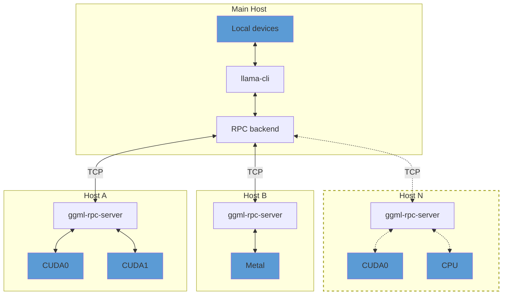

## Overview

> [!IMPORTANT]
> This example and the RPC backend are currently in a proof-of-concept development stage. As such, the functionality is fragile and
> insecure. **Never run the RPC server on an open network or in a sensitive environment!**

The `ggml-rpc-server` allows exposing `ggml` devices on a remote host.
The RPC backend communicates with one or several instances of `ggml-rpc-server` and offloads computations to them.
This can be used for distributed LLM inference with `llama.cpp` in the following way:



By default, `ggml-rpc-server` exposes all available accelerator devices on the host.
If there are no accelerators, it exposes a single `CPU` device.

## This fork: several Macs over Thunderbolt

This fork uses RPC to run one LongHaul model over several Macs connected with Thunderbolt cables. Each Mac holds some of the layers and caches the experts of those layers in its own memory. See [docs/longhaul.md](../../docs/longhaul.md#several-laptops) for how the layers and the cache are split. With `-es` (for example `-es 60`, the remote computes about 60% of the experts) all Macs work on every MoE layer at the same time instead of in turns, see [Expert split](../../docs/longhaul.md#expert-split). For Qwen 3.5 models in memory, `-sm tensor` splits every matrix over two Macs, see [docs/tensor-parallel.md](../../docs/tensor-parallel.md).

1. Build the same commit on every Mac. RPC is built by default on macOS. The server rejects other protocol versions, and both ends must have the same kernels.
2. Connect the Macs with Thunderbolt cables. On each Mac open System Settings -> Network -> Thunderbolt Bridge -> Details -> TCP/IP, set "Configure IPv4" to "Manually" and give each Mac its own address in one subnet, for example `10.0.0.1` for the main Mac and `10.0.0.2`, `10.0.0.3`, ... for the others, with the subnet mask `255.255.255.0`.
3. Copy the GGUF file (all splits of a split file) to each remote Mac as is. The file name may differ.
4. On each remote Mac, start the server on its Thunderbolt address:

   ```sh
   ggml-rpc-server -H 10.0.0.2 -p 50052 --model-dir ~/models
   ```

5. On the main Mac, pass the servers with `--rpc`:

   ```sh
   llama-cli -m ~/models/Inkling-2-Mini-AD-Q4_K.gguf --rpc 10.0.0.2:50052 -lhc 16G

   # or: the remote computes about 60% of the experts of every layer, at the same time as the main Mac
   llama-cli -m ~/models/Inkling-2-Mini-AD-Q4_K.gguf --rpc 10.0.0.2:50052 -es 60 -lhc 16G
   ```

Notes:

- Bind `-H` to the Thunderbolt address, never to `0.0.0.0`. The server has no authentication, so it must only be reachable over the cable between your own Macs. The warning that the host is not `127.0.0.1` is expected. The macOS firewall may ask to allow incoming connections.
- `--model-dir DIR` indexes the `*.gguf` files in DIR (not its subdirectories) at startup and logs each one with its size and fingerprint. The server then reads the missing experts of its layers from its own SSD, instead of receiving them over the link. A file matches when its size and fingerprint (the first 4 MiB and 64 blocks of 4 KiB) match the main Mac's file. The client never sends a path: the server reads only the files it indexed, and checks every range against the file and the tensor. Without a matching file the main Mac sends the experts.
- `--io-threads N` sets the number of concurrent reads from the model files (default: 4).
- With Thunderbolt 4 (and 3) the link is TCP over the Thunderbolt Bridge. Its speed is well below the 40 Gb/s link rate, so measure it (for example with `iperf3`) before you rely on the main Mac sending experts. With Thunderbolt 5 the RDMA transport below can be used.
- Optional: a larger MTU can speed up the Thunderbolt Bridge. Set Details -> Hardware -> MTU to "Custom" (for example 9000) on every Mac, and keep it only if your measurement improves.
- A remote Mac that sleeps, or an unplugged cable, drops the connection, and the main process aborts. Run the server under `caffeinate -i` to keep the Mac awake.

## Usage

### Remote hosts

On each remote host, build the backends for each accelerator by adding `-DGGML_RPC=ON` to the build options.
For example, to build the `ggml-rpc-server` with support for CUDA accelerators:

```bash
mkdir build-rpc-cuda
cd build-rpc-cuda
cmake .. -DGGML_CUDA=ON -DGGML_RPC=ON
cmake --build . --config Release
```

When started, the `ggml-rpc-server` will detect and expose all available `CUDA` devices:

```bash
$ bin/ggml-rpc-server
ggml_cuda_init: GGML_CUDA_FORCE_MMQ:    no
ggml_cuda_init: GGML_CUDA_FORCE_CUBLAS: no
ggml_cuda_init: found 1 CUDA devices:
  Device 0: NVIDIA GeForce RTX 5090, compute capability 12.0, VMM: yes
Starting RPC server v3.0.0
  endpoint       : 127.0.0.1:50052
  local cache    : n/a
Devices:
  CUDA0: NVIDIA GeForce RTX 5090 (32109 MiB, 31588 MiB free)
```

You can control the set of exposed CUDA devices with the `CUDA_VISIBLE_DEVICES` environment variable or the `--device` command line option. The following two commands have the same effect:
```bash
$ CUDA_VISIBLE_DEVICES=0 bin/ggml-rpc-server -p 50052
$ bin/ggml-rpc-server --device CUDA0 -p 50052
```

### Main host

On the main host build `llama.cpp` with the backends for the local devices and add `-DGGML_RPC=ON` to the build options.
Finally, when running `llama-cli` or `llama-server`, use the `--rpc` option to specify the host and port of each `ggml-rpc-server`:

```bash
$ llama-cli -hf ggml-org/gemma-3-1b-it-GGUF -ngl 99 --rpc 192.168.88.10:50052,192.168.88.11:50052
```

By default, llama.cpp distributes model weights and the KV cache across all available devices -- both local and remote -- in proportion to each device's available memory.
You can override this behavior with the `--tensor-split` option and set custom proportions when splitting tensor data across devices.

### Local cache

The RPC server can use a local cache to store large tensors and avoid transferring them over the network.
This can speed up model loading significantly, especially when using large models.
To enable the cache, use the `-c` option:

```bash
$ bin/ggml-rpc-server -c
```

By default, the cache is stored in the `$HOME/.cache/llama.cpp/rpc` directory and can be controlled via the `LLAMA_CACHE` environment variable.

### RDMA transport

The RPC backend can use RDMA instead of TCP for lower latency and higher throughput. The transport is negotiated during the initial handshake -- no changes to command-line usage are required, and the connection falls back to TCP unless both peers can use RDMA.

Two providers are supported, each enabled by default when its library is found at build time:

- **Linux**: RoCEv2-capable NICs (e.g. Mellanox ConnectX), via `libibverbs`.
- **macOS**: RDMA over Thunderbolt on Apple silicon Macs with Thunderbolt 5, via `librdma`. Requires macOS 26.2 or later, with RDMA enabled once from macOS Recovery via `rdma_ctl enable`. See [TN3205](https://developer.apple.com/documentation/technotes/tn3205-low-latency-communication-with-rdma-over-thunderbolt).

RDMA is point-to-point, so each side uses the local device whose GID matches the address the connection was made on. Connect over the RDMA-capable link -- with Thunderbolt, use the peer's Thunderbolt address in `--rpc`; a connection made over another interface stays on TCP.

To force plain TCP without rebuilding, set `GGML_RPC_NO_RDMA` on either peer:
```bash
$ GGML_RPC_NO_RDMA=1 bin/ggml-rpc-server
```

### Troubleshooting

The `GGML_RPC_DEBUG` environment variable controls the verbosity of the logs emitted by the RPC backend.
It can be set on the server, on the client (e.g. `llama-cli`), or both. Larger values produce more detailed output:

- unset / `0` - disabled (only warnings and errors are printed)
- `1` - high-level events: connections, handshake, buffer allocations, graph computes, cache evictions
- `2` - per-command trace: every RPC message sent/received, tensor transfers, cache hits/misses
- `3` - fine detail: per-command timings, graph node dumps, transport byte counts

Non-numeric values are treated as `1`.

```bash
$ GGML_RPC_DEBUG=1 bin/ggml-rpc-server
```

> [!NOTE]
> The debug levels are emitted as `ggml` debug records, which `llama.cpp` applications drop unless the
> global verbosity threshold is raised. On the client, pass `-lv 5` together with `GGML_RPC_DEBUG`:

```bash
$ GGML_RPC_DEBUG=2 bin/llama-cli -hf ggml-org/gemma-3-1b-it-GGUF -ngl 99 --rpc 192.168.88.10:50052 -lv 5
```

